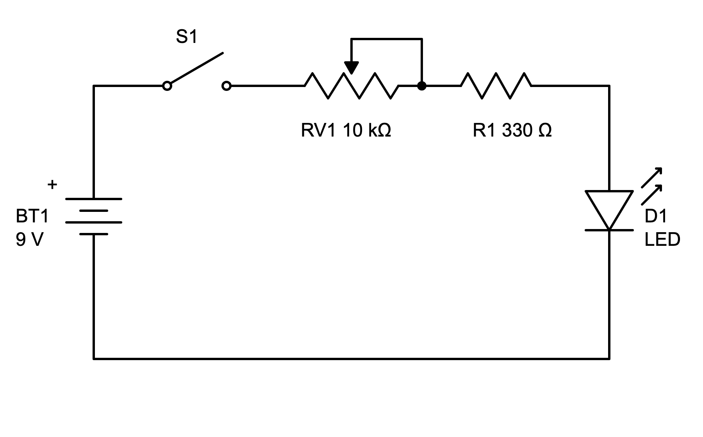
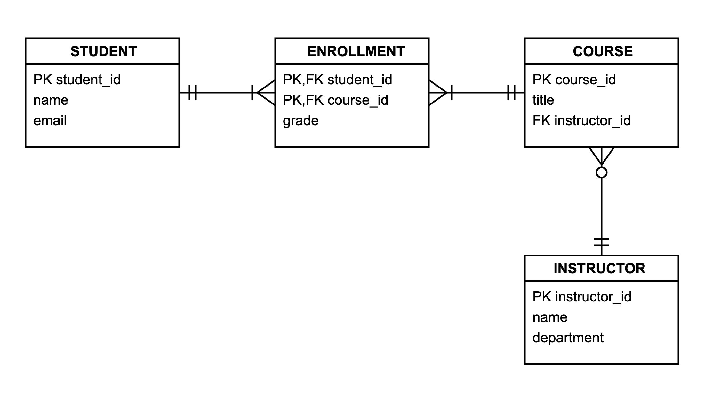
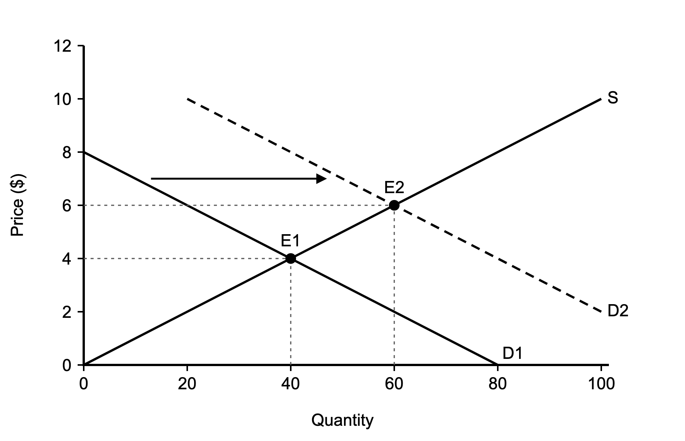
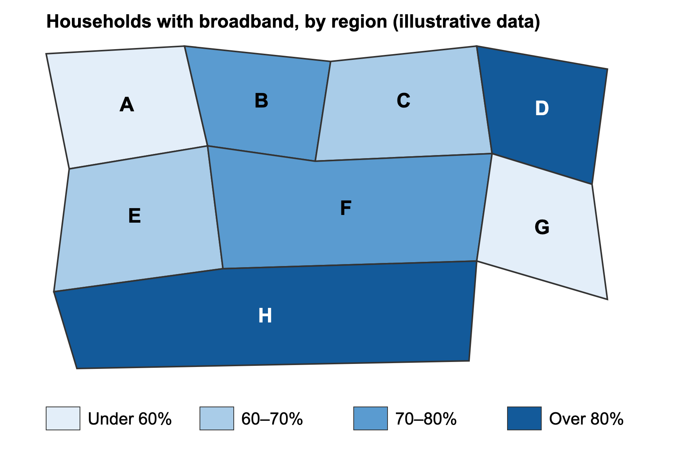

# Check Ally's scores · for Rick

Ally's sentences are from one run each, November 5. The scores are my reading, and they're on slide 10.

**Rick, November 5: agreed with the close calls below and kept the scores.**

## How to verify

1. **Check the key against the drawing.** Open the image and its `.key.txt` in `../test-specimens/`.
   If the key is wrong, the score is wrong.
2. **Read Ally's sentence against each check.** A check passes only if the sentence states it. Fill in
   your ruling where you disagree, and I'll update the slide.
3. **Optional: see it yourself.** In the sandbox, open
   [ally-test-2026-11-05](https://rutgers.instructure.com/courses/375349/files/folder/ally-test-2026-11-05),
   click an image's dial, then **Auto-generate description**. Close the panel with the X; **Add** would
   save it. The wording may differ from mine: I didn't test whether it changes from run to run.

## Schematic: 3 of 7 (2 if you rule strictly)

> Circuit diagram with 9V battery, switch S1, 10kΩ potentiometer RV1, 330Ω resistor R1, and an LED D1 connected in series.

| Check | Mine | Why | Your ruling |
|---|---|---|---|
| 1. All five parts and values | Pass | All there | |
| 2. Connection order | **Pass, close call** | It lists them in loop order and says "in series", but doesn't say what connects to what | |
| 3. S1 is drawn open | Miss | Not mentioned | |
| 4. Wiper tied to one end of RV1 | Miss | Not mentioned | |
| 5. LED polarity | Miss | Not mentioned | |
| 6. Battery polarity | Miss | Not mentioned | |
| 7. Adds nothing it can't support | Pass | Says nothing about it lighting | |

## Entity diagram: 1 of 7

> Entity-relationship diagram showing Student, Enrollment, Course, and Instructor tables with keys and connecting relationships.

| Check | Mine | Why | Your ruling |
|---|---|---|---|
| 1. All entities and every attribute | Miss | Entities only | |
| 2. PK and FK markings | Miss | Only the word "keys" | |
| 3. Student–Enrollment cardinality | Miss | Not mentioned | |
| 4. Course–Enrollment cardinality | Miss | Not mentioned | |
| 5. Instructor–Course is zero or many | Miss | Not mentioned | |
| 6. Direction of the many side | Miss | Not mentioned | |
| 7. Adds nothing | Pass | | |

## Supply and demand: 4 of 7 (3 to 5, depending on the close calls)

> Supply and demand graph showing demand curve shifting right from D1 to D2, moving equilibrium from E1 (40,$4) to E2 (60,$6).

| Check | Mine | Why | Your ruling |
|---|---|---|---|
| 1. Axes, labels, ranges | Miss | "$4" hints at price, but no axes | |
| 2. S rises; D1 and D2 fall | Miss | Not mentioned | |
| 3. D2 dashed, right of D1 | **Miss, close call** | Right of D1 is there; dashed isn't | |
| 4. E1 at (40, 4) | Pass | | |
| 5. E2 at (60, 6) | Pass | | |
| 6. Arrow's direction | **Pass, close call** | "Shifting right" matches, but it never mentions an arrow | |
| 7. No added cause or prediction | **Pass, close call** | No cause, but "shifting" and "moving equilibrium" read the figure as a story. Gemini passed on the same words | |

## Map: 1 of 10

> Map chart titled "Households with broadband, by region" showing eight labeled regions (A–H) shaded in four colors representing broadband adoption ranges.

| Check | Mine | Why | Your ruling |
|---|---|---|---|
| 1–8. Each region in the right band | Miss, all 8 | Gives no region's band | |
| 9. Data in text, not just colours | Miss | | |
| 10. No added conclusion or exact values | Pass | It does drop "illustrative data" from the title, which no check covers | |

## Is the column fair?

The keys were written for a full description, and Ally writes one sentence. I suggest keeping the
scores and saying so out loud. The alternative is to replace them on the slide with one word per
diagram, like "Label only".
